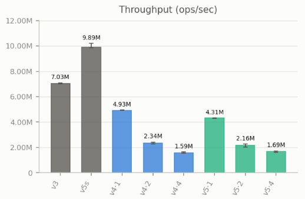
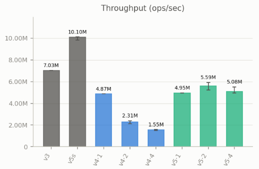
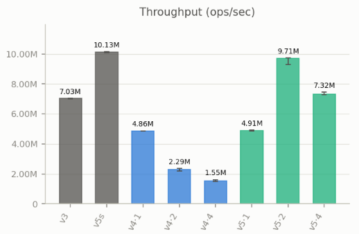

# Throughput Analysis

In the previous section, the [fine-grained engine](./4_fine_grained.md) design has been explained. In this section, we will analyze the engine's throughput and identify the scalability bottlenecks. 

## Patch 1: Global `logs` and `logs_mutex`

As provided in the [previous section](./4_fine_grained.md), the log management depends on a global `logs` vector and a global `logs_mutex` mutex. The vector is shared across all threads and lock need to be acquired every time. Observe the corresponding implementation below. 

```c++
void EngineV5::match() {
    ...
    while (top_bids >= lowest_asks) {
        ...
        if (highest_buy_order.count > lowest_sell_order.count) {
            ...
            {
                std::lock_guard<std::mutex> logs_lock{logs_mutex};
                logs.push_back(Log(LogType::Match, Transaction(highest_buy_order.order_id, lowest_sell_order.order_id, lowest_sell_order.count)));
            }
            ...
        }
        else if (highest_buy_order.count < lowest_sell_order.count) {
            ...
            {
                std::lock_guard<std::mutex> logs_lock{logs_mutex};
                logs.push_back(Log(LogType::Match, Transaction(highest_buy_order.order_id, lowest_sell_order.order_id, highest_buy_order.count)));
            }
            ...
        }
        else {
            {
                std::lock_guard<std::mutex> logs_lock{logs_mutex};
                logs.push_back(Log(LogType::Match, Transaction(highest_buy_order.order_id, lowest_sell_order.order_id, highest_buy_order.count)));
            }
            ...
        }
    }
    ...
}

void EngineV5::process(const Order &order) {
    switch (order.order_side) {
    case OrderSide::Sell: {
        if (!is_matching.load(std::memory_order_seq_cst)) {
            ...
            if (lowest_asks <= order.price) {
                ...
                {
                    std::lock_guard<std::mutex> logs_lock{logs_mutex};
                    logs.push_back(Log(LogType::Receive, order));
                }
                ...
            }
        }
        ...
        {
            ...
            {
                std::lock_guard<std::mutex> logs_lock{logs_mutex};
                logs.push_back(Log(LogType::Receive, order));
            }
            ...
        }
        ...
    }
    case OrderSide::Buy: // Similar to OrderSide::Sell
    }
}
```

This design limits the throughput to scale due to contention. Conceptually, under unmatched mixed workload, the throughput of fine-grained engine should scale. This is because `is_matching` will mostly be false and `lowest_asks <= order.price` (for sell) and `top_bids >= order.price` (for buy), so the fine-grained path will mostly be taken. 

However, when benchmarked, the following result is obtained. When 2 threads are used in engine v5, the throughput is worse than engine v4, the coarse-grained version. 

{ width="650" style="display:block; margin:0 auto;" }

More measurement data for this patch can be found under `results/multithread_bench_old/` folder. 

This result highlights the importance of using as few synchronization mechanisms as possible. While adding `std::lock_guard` seems very simple, it could introduces huge overhead that limit throughput scaling. 

## Patch 2: Per-thread `logs`

Instead of having global `logs` and guard it with `logs_mutex`, we will allocate a private `cur_logs` for each thread. With this, we no longer need any mutex when storing into `cur_logs` as each thread has their own copy. 

When benchmarked, the following result is obtained. Improvement now can be seen, the throughput of engine v5 with 2 threads now is higher than that with 1 thread. 

{ width="650" style="display:block; margin:0 auto;" }

More measurement data for this patch can be found under `results/multithread_bench_not_padded/` folder. 

## Patch 3: Padded `mutex` and `shared_mutex`

However, in Patch 2, the throughput scaling is still limited due to false sharing. On this machine, measured with g++ 13.3, the size of `std::mutex` and `std::shared_mutex` are 40 and 56 respectively; the cache line is 64 bytes. When these are arranged in an array, most `std::mutex`s will be located at separate cache line, introducing false sharing. 

```c++
std::array<std::mutex, MAX_PRICE + 1> bids_mutex;
std::array<std::mutex, MAX_PRICE + 1> asks_mutex;
```

To avoid this, we create `PaddedMutex` and used it inside the array. 

```c++
struct alignas(64) PaddedMutex
{
    std::mutex mtx;
};

std::array<PaddedMutex, MAX_PRICE + 1> bids_mutex;
std::array<PaddedMutex, MAX_PRICE + 1> asks_mutex;
```

When benchmarked, the following result is obtained. Comparing engine v5 with 1 and 2 threads, we can indeed observe that the throughput scale. 

{ width="650" style="display:block; margin:0 auto;" }

More measurement data for this patch can be found under `results/multithread_bench/` folder. 

However, the throughput of engine v5 with 2 threads cannot beat engine v5s. This can be attributed to the overhead of synchronization primitives, which can be observed by comparing throughput of engine v5s and engine v5 with 1 thread; both of them run on a single thread, so all the overhead can be attributed to the sole differentiator, i.e., the synchronization primitives. 